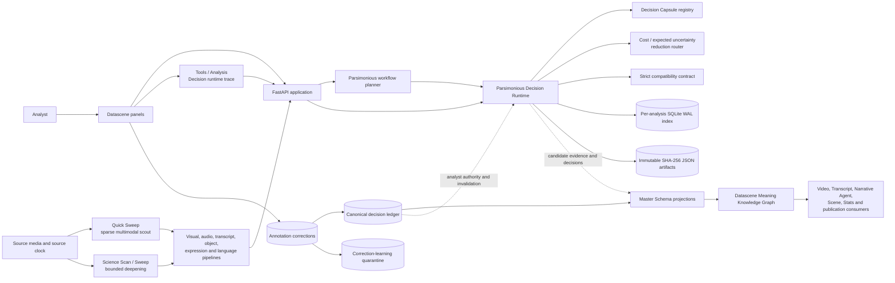

# Datascene Software Architecture Map

Status: authoritative living map  
Updated: 2026-11-04

This map distinguishes operational repository software from affiliated development
that is **to be made**. A schema or design proposal is not marked operational
without a runtime implementation and entry point.

## Operational architecture



The dotted runtime-to-Master path is governed: machine output remains candidate
material. It cannot become canonical because it was reused, inexpensive, or
scored highly. Analyst-confirmed decisions travel through the append-only ledger.

## Implemented components

| Component | Runtime responsibility | Principal implementation |
|---|---|---|
| Quick Sweep | Sparse audio, object, face and expression scouting at the configured coarse interval | `api_server.py::resolve_analysis_profile` |
| Science Sweep workflow | Deepens declared uncertainty hotspots and researcher-priority intervals | `src/backend/analysis/parsimonious_workflow.py` |
| Tracking programs | Plans Narrative agents, actions/movements and episodic scene continuums | `parsimonious_workflow.py::TRACKING_PROGRAMS` |
| Content-addressed store | Writes immutable evidence, feature, result, decision, manifest, invalidation, trace and learning artifacts | `parsimonious_runtime.py::ParsimoniousRuntime` |
| Persistent indexes | Per-analysis SQLite WAL indexes compatibility, features, capsules, invalidations, traces and learning states | `parsimonious_runtime.sqlite3` |
| Compatibility contract | Requires source, clock, exact scope, dependencies, correction, ontology, preprocessing, model, calibration, capsule, feature-schema and parameter versions | `normalize_compatibility` |
| Decision Capsule registry | Eight versioned tasks with features, rules, provider, calibration, thresholds, cost, hardware, authority and dependencies | `INITIAL_CAPSULES` |
| Cost-aware router | Reuses first, then selects the lowest incremental computational cost per expected uncertainty reduction | `ParsimoniousRuntime.route` |
| Score semantics | Separates rules, similarity, uncalibrated scores, calibrated probabilities, conformal sets and analyst decisions | `validate_score` |
| Selective invalidation | Retires only indexes whose dependency fingerprints changed; immutable artifacts remain auditable | `ParsimoniousRuntime.invalidate` |
| Runtime trace | Persists routing receipts outside graph space and exposes them in Tools → Analysis | runtime API and trace inspector |
| Correction-learning separation | Canonical decisions govern the analysis while a separate snapshot enters learning at `captured` | canonical decision API and learning quarantine |
| Learning governance | Enforces captured → consent/quarantine → eligible → named manifest → evaluated → approved transitions | `transition_learning` |
| Canonical authority | Keeps analyst decisions append-only and projects valid authority to consumers | `decision_ledger.py`, `claim_projection.py`, `canonical_adapter.py` |

## Runtime storage map

```text
outputs/api_results/{analysis_id}/
├── parsimonious_runtime.sqlite3
├── parsimonious_artifacts/sha256/{prefix}/{digest}.json
├── parsimonious_workflow_plan.json
├── decision_ledger.json
├── annotation_corrections.json
└── existing pipeline and projection artifacts
```

SQLite is the transactional index. Immutable JSON files are replayable records.
Changed knowledge creates a new artifact and, when required, an invalidation event.

## Runtime API map

| Route | Function |
|---|---|
| `POST/GET /api/analysis/{id}/parsimonious-workflow/plan` | Persist or reopen a source-bound Quick/Science plan |
| `GET /api/analysis/{id}/parsimonious-runtime` | Inspect counts, capsules and recent traces |
| `POST .../parsimonious-runtime/evidence` | Persist an immutable evidence slice |
| `POST .../parsimonious-runtime/features` | Persist or exactly reuse a feature snapshot |
| `POST .../parsimonious-runtime/manifests` | Persist model, ontology, calibration, preprocessing or training manifests |
| `POST .../parsimonious-runtime/results` | Persist typed candidate or explicit analyst decisions |
| `POST .../parsimonious-runtime/route` | Reuse, apply a rule, select a provider, abstain or request review |
| `POST .../parsimonious-runtime/invalidate` | Append invalidation and retire affected indexes |
| `POST .../parsimonious-runtime/learning` | Capture a correction with no training effect |
| `POST .../learning/{learning_id}/transition` | Apply a governed learning transition |

## Authority and data movement

1. Raw pipeline output is evidence, never analyst truth.
2. Exact compatible results and features are reused before computation.
3. Deterministic rules precede classifier work when declared evidence is present.
4. Routing minimizes incremental cost per expected uncertainty reduction.
5. Results retain score semantics; only calibrated probabilities are probabilities.
6. Machine results stop at the candidate authority ceiling.
7. Explicit analyst decisions enter the canonical ledger and govern projections.
8. The same correction enters learning as `captured`, with no training effect.
9. Dependency changes append invalidations and trigger selective recomputation.

## To be made

The following affiliated developments are not delivered capacity.

### Pipeline and scheduler integration — to be made

- Automatically publish every eligible pipeline feature family into the shared
  store without manual API calls.
- Add capsule-worker adapters that execute each selected local or specialist
  provider and commit typed results and resource receipts.
- Let Quick Sweep automatically generate hotspots and enqueue bounded Science Sweep work.
- Batch compatible work while retaining source isolation and analyst priority.
- Add resumable worker leases, cancellation and crash recovery.

### Shared multimodal feature substrate — to be made

- Governed reusable visual, face, object, motion, audio, voice, prosody, text and
  metadata embeddings with explicit manifests.
- Proven cross-task embedding reuse for clustering, retrieval, classification and
  constellation matching.
- Reference-safe storage compaction, retention and garbage collection.

### Advanced classification and temporal reasoning — to be made

- Validated multi-task capsule heads over frozen local representations.
- Temporal decision memory for agents, actions, movements and episodic continuums.
- Graph-conditioned reasoning that cannot use candidate edges as self-support.
- Conformal prediction sets and domain-specific abstention calibration.
- Mini-story assembly using agents, actions, objects, settings, dialogue and sound.

### Analyst review and empirical validation — to be made

- An unrecognized-evidence workbench with source navigation and batch adjudication.
- Active-review ranking by expected downstream uncertainty and computation saved.
- Corpus-wide resolved, ambiguous, conflicting, unsupported and unfamiliar audits.
- Frozen source-grouped benchmarks and calibration reports for every capsule.

### Hardware and operational economics — to be made

- Live CPU, Metal, CUDA and optional hosted-provider discovery.
- Measured wall time, CPU/GPU seconds, peak memory and energy in place of estimates.
- Hardware-aware batching under an analyst-defined quality floor.
- Per-media-hour cost, reuse, review-effort and downstream-error dashboards.

### Governed learning and deployment — to be made

- Consent-management UI and rights metadata for correction-derived examples.
- Named immutable training manifests with source-grouped splits and deduplication.
- Offline training/evaluation runners separated from the analytical runtime.
- Signed model/calibration artifacts, promotion review, staged deployment and rollback.
- Drift monitoring that can quarantine a capsule without rewriting history.

## Related contracts

- `docs/schemas/datascene.parsimonious_decision_engine.1.0.schema.json`
- `docs/datascene_parsimonious_decision_engine_2.0_design.md`
- `docs/vaa1_canonical_architectural_revamp_delivery_2026-07-15.md`
- `docs/datascene_meaning_knowledge_graph_information_architecture_contract_2026-11-02.md`
